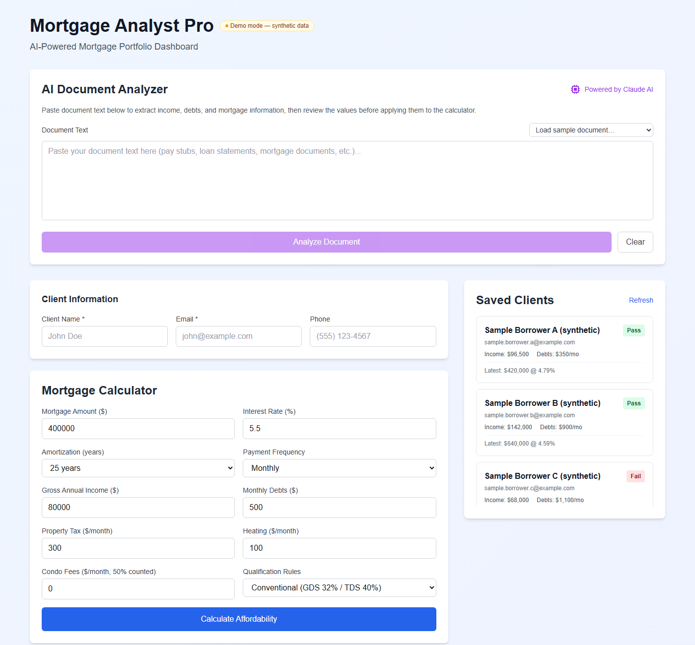

# Mortgage Analyst Pro

[](https://github.com/y4medi/mortgage-analyst-pro/actions/workflows/ci.yml)

**Live demo:** https://mortgage-analyst-pro.vercel.app (demo mode: synthetic borrowers and sample documents, no database or API key)

A broker-side workbench for Canadian residential mortgages. Paste an employment letter, pay stub or
debt summary, and the app extracts income, debts and mortgage terms (Claude AI, or a deterministic
parser in demo mode) and shows them with their source lines so a human can review them before they
go into the calculator. The calculator then runs GDS/TDS affordability, the federal stress test, and
maximum-mortgage calculations using Canadian rules. Clients and scenarios can be saved and reopened.
It exists to show the end-to-end flow a mortgage-tech implementation has to get right: messy document
in, auditable numbers out, with a person signing off in between.



## Features

- **AI document intake with human review**: extracts income, monthly debts, principal, rate and
  amortization; shows confidence and source lines, and applies values only when the broker clicks
  *Apply to calculator*.
- **Affordability**: GDS and TDS with property tax, heating and 50% of condo fees.
- **Qualification presets**: Conventional (32% / 40%) or CMHC insured (39% / 44%), selectable in
  the form and threaded through every calculation.
- **Stress test**: qualifying rate, pass/fail at that rate, and maximum mortgage at contract vs.
  qualifying rate. The ratio that limits the amount (GDS or TDS) is reported.
- **Payment frequencies**: monthly, semi-monthly, bi-weekly, weekly, accelerated bi-weekly/weekly.
- **Charts** (Recharts): rate sensitivity, yearly amortization, and amortization-period comparison.
- **Client book**: save clients and mortgages (PostgreSQL via Prisma, or the in-memory demo store).
- **Runs with zero secrets**: a demo mode for public deployments (see below).

## Canadian rules implemented

| Rule | Implementation (`lib/math/`) |
|---|---|
| Semi-annual compounding | periodic rate `i = (1 + r/2)^(2/n) − 1`, where `n` is payments per year |
| Payment | `P = L · i(1+i)^N / ((1+i)^N − 1)`, with `N = years × n`. Check: $500,000 @ 5% / 25y monthly = **$2,908.02** |
| Accelerated payments | accelerated bi-weekly = monthly / 2, accelerated weekly = monthly / 4 |
| GDS | `(mortgage payment + property tax + heating + 50% condo fees) / gross monthly income` |
| TDS | `(GDS housing costs + other monthly debts) / gross monthly income` |
| Ratio limits | Conventional 32 / 40, CMHC insured 39 / 44 (`QUALIFICATION_PRESETS`) |
| Stress test (MQR) | qualify at `max(contract rate + 2%, 5.25%)`: OSFI B-20 for uninsured loans, federal MQR for insured loans. The floor is one constant, `MINIMUM_QUALIFYING_RATE` |
| Maximum mortgage | monthly budget = `min(GDS% · income, TDS% · income − debts) − (tax + heat + 50% condo)`, inverted back to principal for the chosen frequency |

The math is pure TypeScript with no framework dependencies and is covered by unit tests.
`docs/precision-analysis.md` covers floating-point and rounding choices.

## Architecture

```
app/
  page.tsx                      Dashboard (client component)
  actions/saveCalculation.ts    Server action: upsert client + save mortgage
  api/clients, api/mortgages    REST route handlers
  api/ai/analyze-document       Claude extraction, or rule-based in demo mode
  api/status                    Reports demo/live mode (booleans only, no secrets)
components/                     Form, results, AI panel, client sidebar, charts
lib/math/                       Payment, affordability, stress test, sensitivity (pure functions)
lib/data/repository.ts          Repository interface: Prisma/PostgreSQL or in-memory store
lib/data/demo-seed.ts           Synthetic borrowers for demo mode
lib/runtime-mode.ts             Detects which backends are configured
services/ai/                    Claude client (document-analyzer) + rule-based extractor
public/samples/                 Synthetic sample documents
__tests__/                      Jest unit tests
```

```
 document text ──► /api/ai/analyze-document ──► Claude (key set) │ regex rules (demo)
                                                     │
                              broker reviews values + source lines, clicks "Apply"
                                                     ▼
 calculator form ──► lib/math (GDS/TDS, stress test, max mortgage, charts)
        │
        └──► saveCalculation / API routes ──► repository ──► PostgreSQL │ in-memory
```

## Demo mode

A public deployment should work for anyone who opens the link, so neither secret is required:

| Missing variable | Fallback |
|---|---|
| `DATABASE_URL` | In-memory repository seeded with four clearly fictional borrowers ("Sample Borrower A–D", `@example.com`, 555-01xx numbers). Writes work but reset when the server restarts or a serverless instance is recycled. |
| `ANTHROPIC_API_KEY` | Deterministic regex extraction (income, pay-frequency-annualised pay stubs, debt payments, rate, amortization, principal). Responses are flagged `mode: "demo"` and include the matched line for each value. |

When either fallback is active, the header shows a small **Demo mode — synthetic data** badge. Use
*Load sample document* in the AI panel to try the three synthetic documents in `public/samples/`.

## Running locally

```bash
npm install
npm run dev            # http://localhost:3000, demo mode if no .env
```

To use PostgreSQL and Claude, copy `.env.example` to `.env` and set either or both variables:

```bash
DATABASE_URL="postgresql://..."      # then: npx prisma migrate deploy (or prisma db push)
ANTHROPIC_API_KEY="sk-ant-..."
# ANTHROPIC_MODEL="claude-sonnet-5-5"  # optional override
```

## Tests and CI

```bash
npm test               # Jest unit tests (math engine, demo repository, rule-based extractor)
npx tsc --noEmit       # type check
npm run lint
npm run build
```

GitHub Actions (`.github/workflows/ci.yml`) runs install, Prisma generate, lint, type check, tests
and build on every push and pull request. CI needs no secrets.

## Limitations

- **Not lender advice.** The ratios and stress test follow published federal and CMHC guidelines.
  Real lenders and insurers add their own policies (credit-score tiers, rental offsets,
  self-employed income, heating defaults, the 30-year insured amortization rules, and so on). Do
  not use the output to make a credit decision.
- **Synthetic data only.** Demo borrowers and sample documents are fictional. Do not upload real
  personal financial information to a public demo.
- The rule-based extractor is intentionally simple and only recognises common phrasings. Claude
  output can also be wrong. That is why extracted values always go through human review.
- Property tax, heating, condo fees and the qualification preset are not saved yet. The Prisma
  schema only stores client income/debts and mortgage terms.
- No authentication or multi-tenant isolation. It is a portfolio project, not a production system.

## More docs

- `docs/precision-analysis.md`: floating-point and rounding analysis
- `docs/architecture-notes.zh.md`: original architecture notes (Chinese)
- `docs/original-plan.md`: initial build plan (historical)
